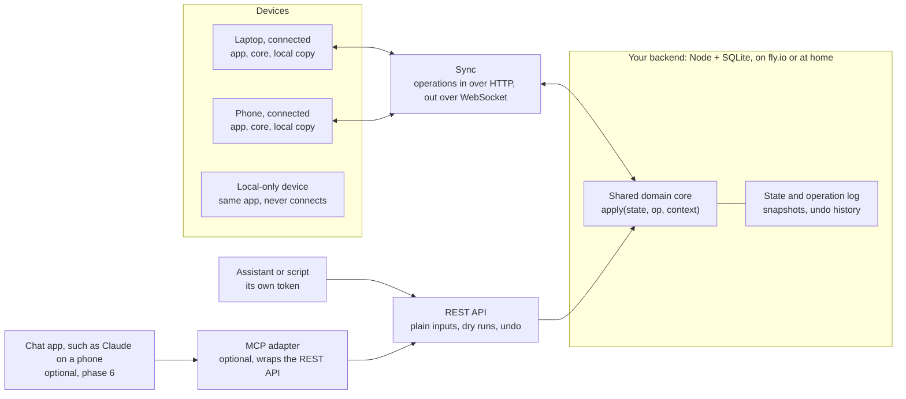

# TaskFlow sync and API design

Design doc · draft · 2026-10-26

TaskFlow stays a local-first app with no accounts. Anyone who wants their tasks on several devices, or wants an AI assistant to manage them, runs a small sync backend and points the app at it in Settings. Using the app on localStorage alone stays the default and stays fully supported.

## Goals and non-goals

Goals:

- **An optional, self-hostable backend.** The app works exactly as today with no backend. Connecting one adds sync; it never gates a feature. Anyone can run one.
- **One person's data on many devices.** Tasks, the schedule, fixed blocks, work hours and the running timer appear on every connected device within a second or two.
- **An assistant as a first-class writer.** Through the backend's REST API, an AI assistant can list tasks, add and edit them, schedule them and run the auto-scheduler, with the same results as the buttons in the app.
- **Offline keeps working.** A connected device without a network still works, and catches up when it reconnects.

Non-goals for now:

- Accounts, login screens, or a hosted multi-user service. A hosted service would just be one more backend with its own login, and would need no app changes.
- Sharing a schedule with other people, teams or delegates.
- End-to-end encryption. The backend has to read the data to run the scheduler and answer the API (see [Security](#security-privacy-and-data-ownership)).
- Calendar import or export (Google, iCal). Worth doing later, on top of the same API.

## Where the code stands today

Most of what sync needs is already in place; three things are not. The scheduling logic is plain JavaScript and can run on a server, but it reads the system clock implicitly, and the app saves its whole state as one blob.

| Aspect | Today | What it means for sync |
| --- | --- | --- |
| Store API | `tasks.svelte.js` and `schedule.svelte.js` export about 25 operations: `addTask`, `editTask`, `completeTask`, `scheduleTaskNext`, `autoScheduleAll`, `commitOutlookDrop`, `startTimer`, `addFixedBlock`, `updateWorkSchedule` and more | Already shaped like a command set. These become the operations every client sends |
| Scheduling logic | `scheduler.js`, `scheduling.js`, `envelope.js`, `calendar.js`, `outlook-scheduler.js` have no DOM dependency | The backend can run the same code, so an API call to "schedule this" matches the app's button exactly |
| IDs | Tasks and fixed blocks get `crypto.randomUUID()` on the client; scheduled blocks get an id derived from task, day and start (since phase 2) | Records can be created offline without asking the backend for an ID, and an operation replayed elsewhere creates the same blocks |
| Deletes | Soft (`isDeleted: true`) | Deletions travel as ordinary updates instead of vanishing |
| Saving | `saveState` writes tasks, work schedule, timer and fixed blocks as one localStorage blob on every change | Syncing that blob would let two devices silently overwrite each other. Needs replacing with operations |
| Clock | The scheduler calls `new Date()` throughout | Results depend on when the code happens to run, so the backend and a device can't be guaranteed to agree. `now` must be passed in |
| Timezone | Day boundaries and work hours use the machine's local time | Fine on a device. On a backend, the process timezone has to be set to the user's (see [Time and timezones](#time-and-timezones)) |
| Timestamps | Tasks carry `lastModifiedAt`; fixed blocks and the work schedule do not | Rules out simple per-record "last write wins", which is one more reason to sync operations |
| Device settings | Theme in `taskflow_theme`, panel width in `taskflow_layout` | Separate keys already, which makes the device versus backend split easy |

One correction surfaced while checking: `CLAUDE.md` says the auto-scheduler scales durations by `estimationMultiplier`. It does not; only `InsightsModal` reads it. That matters once the backend runs the scheduler (see [Open questions](#open-questions)).

## Architecture

Every writer sends operations to the backend, which applies them with the same domain core the browser runs. Writers here means the app on each connected device, assistants and scripts. The frontend stays a static site on GitHub Pages; only connected devices talk to a backend, and which backend is a setting on each device.



Connected devices send operations with `POST /v1/ops` and receive every device's operations over one WebSocket. Assistants and scripts use the REST API with their own token. Chat apps that can only connect through MCP connectors would reach the same API through an optional adapter. A local-only device runs the identical app and core but never connects.

Three rules hold the design together:

- **Local-first.** Each device keeps a full copy and applies its own changes instantly. A backend is a sync target the copies agree through, not a replacement for local storage: if it were, every drag would wait on the network and offline use would stop working.
- **Operations, not state.** Devices never upload their whole state. They send intents like `schedule.next`, which the backend re-applies to the current state.
- **One writer per backend.** The backend applies operations one at a time, so phone, laptop and assistant can never overwrite each other.

## The domain core

Every change to the data goes through one pure function, `apply(state, op, context)`, shared by the browser and the backend. It is extracted from the Svelte stores, which become thin wrappers that call it and hold the result in `$state`.

The pieces:

- **State.** One plain object: `{ tasks, workSchedule, fixedBlocks, activeTimer }`, plus a `version` once a backend is involved. Small enough to ship whole: a heavy user has a few hundred tasks, tens of kilobytes.
- **Operation.** `{ id, type, args, at, tz, actor }`. `id` is a client UUID, so a retried send is applied once. `at` is when the operation was issued. `tz` records the issuer's IANA timezone. `actor` is `app`, or the name of the token that sent it.
- **Context.** `{ now }`, taken from the operation's `at`. Nothing in the core calls `new Date()`; the schedulers take `now` from the context instead. Timezone is the host's local time by contract (see [Time and timezones](#time-and-timezones)).
- **Result.** The new state plus a short summary of what changed, which the API returns as its answer.

Passing the clock in is what makes the core portable. With `now` fixed by the operation, a device and the backend compute the same slot for the same operation, and the logic becomes testable for the first time.

The core is deterministic as well as clock-free: it draws no random numbers, so the same operation on the same state gives the same state everywhere, ids included. Blocks the schedulers create take an id derived from task, day and start minute rather than a random one; a task's blocks never overlap, so that is unique.

Operations are absolute where they can be. Locking a task is `task.setLock { locked: true }`, not a toggle, because a toggle replayed on newer state can flip the wrong way. `task.add` and `block.add` carry the client-generated id, so later operations that refer to a new record still work after a replay.

The operation catalogue, grouped:

| Group | Operations |
| --- | --- |
| Tasks | `task.add`, `task.edit`, `task.complete`, `task.restore`, `task.delete`, `task.setLock`, `task.setRemaining`, `task.setElapsed` |
| Scheduling | `schedule.next`, `schedule.place`, `schedule.unschedule`, `schedule.auto`, `schedule.clear`, `schedule.outlookMove` |
| Timer | `timer.start`, `timer.pause`, `timer.resume`, `timer.finish` |
| Settings | `hours.update`, `block.add`, `block.edit`, `block.remove` |
| Data | `data.import` (replace everything with an export file's contents) |

Each maps one to one onto an existing store function (except `data.import`, added in phase 2), so the refactor moves code rather than redesigning it. `schedule.place` is what a drag commits; `schedule.next` is the ✦ button.

## Sync protocol

Devices send operations, the backend applies them one at a time in arrival order, and every device converges on the backend's state. Operations are intents ("schedule this at the next free slot") rather than diffs, so replaying one on newer state is well-defined: it simply finds the slot that is free now.

One round trip:

1. The device applies the operation locally at once, so the UI never waits, and adds it to a pending queue saved in localStorage.
2. It sends the operation with the state version it was applied on.
3. The backend applies it with `apply`, increments the version, appends it to the log, and acknowledges with the new version.
4. The backend pushes the new operations to every other connected device over a WebSocket.
5. A device receiving newer state replaces its base state and replays its still-pending operations on top. Anything the backend already applied is dropped from the queue by operation `id`.

On the device this is `src/sync/replica.js`: a pure replica of `{ base, version, pending }` whose current state is `base` with `pending` replayed on top. Local-only mode acknowledges each operation as soon as it is applied, so the queue is empty between operations. When the backend's batch is exactly the device's oldest pending operations in order, the replica reuses the state it already computed instead of replaying.

Behaviour in the awkward cases:

- **Offline.** The queue grows; on reconnect the device sends it in order, then pulls the operations it missed since its last version.
- **Two devices at once.** The backend's order wins. Both devices end up with the same state, and neither loses an edit, because each edit is an operation, not a snapshot of the whole list.
- **The assistant runs auto-schedule while you drag a block on your phone.** Whichever arrives second is applied to the result of the first. Your drag is not undone by a stale copy of the plan.
- **The timer.** `activeTimer` lives in shared state, so starting it on the phone and stopping it on the laptop is just two operations. The running time is computed from `startedAt`, so devices agree without ticking over the network.
- **A rejected operation.** Rare, since most operations re-evaluate against current state. When one fails (completing a task that was deleted elsewhere), the backend returns an error for that operation, and the device drops it and shows a short notice.

History: the backend keeps the operation log plus a periodic snapshot, so a newly connected device loads the latest snapshot and the few operations after it. The log is also what makes undo and a "changed through the API" history possible.

## The protocol contract

Because anyone can host a backend, the interface between app and backend is a written, versioned contract. In practice most people will run the reference backend, but the contract is what the app relies on, and a conformance test suite ships with it so another implementation can check itself.

| Endpoint | Purpose |
| --- | --- |
| `GET /v1/info` | Unauthenticated. Returns `{ name, protocol, coreVersion, features, homeTimeZone }` |
| `GET /v1/state` | `{ version, state, hash }` |
| `GET /v1/ops?since=<version>` | `{ version, ops, hash }`: operations after a version. `410 Gone` if that history was pruned, `409` if the version is ahead of the backend; either means reload the state |
| `POST /v1/ops` | `{ ops: [...] }`, applied in order. Returns `{ version, hash, results }`, one result per operation: `applied` (with its version, the time it was applied at, and the operation's result), `duplicate` (an id already applied; nothing happens) or `rejected` (with a reason; the rest of the batch still applies) |
| `GET /v1/stream` | WebSocket. Pushes `{ type: 'ops', version, ops, hash }` for every applied batch |

Everything except `/v1/info` needs `Authorization: Bearer <token>`. Browsers can't set headers on a WebSocket, so the stream authenticates with a first message carrying the token instead, rather than putting it in the URL where proxies log it: `{ type: 'auth', token, since }`. The backend answers with the operations after `since` (or `{ type: 'reset' }` if it can't), then `{ type: 'ready', version }`. A wrong or revoked token closes the stream with code 4401. Errors elsewhere are `{ error: { code, message } }`.

**The state hash.** Every batch and every state carries `hash`, a fingerprint of the state after it (`stateHash` in `src/core/state.js`). A device replays a batch and compares. A different hash means it can't reproduce the backend's state, because the two run different cores or compute in different timezones, so it reloads the backend's state instead of keeping its own answer. This is what makes core skew safe rather than just visible.

**Times.** An operation is applied with its own `at`, so replays agree. One stamped more than two minutes in the future (a fast device clock) is applied at the backend's time instead, and the log records the time it was applied at.

**Versioning.** `protocol` is an integer. Additive changes, such as a new optional field, don't bump it; a breaking change does. The app checks it on connect and refuses an incompatible backend with a clear message. New operation types are announced in `features`, and the app never sends an operation the backend doesn't list.

**Core skew.** The backend re-applies operations with its own copy of the domain core, so app and backend must agree on what an operation does. A backend running an older scheduler would place tasks differently from the device that issued the operation. `coreVersion` makes that visible: the app shows a notice when it differs from its own, and the reference backend is built from the same repo so they move together. It is a hash of the source of `src/core/apply.js` and everything it imports (`scripts/core-version.mjs`), computed by Vite at build time and by the backend at startup, so it changes exactly when the code that applies operations does. The state hash above keeps devices correct while the versions differ: the backend's result always wins.

## Connecting a backend

Local-only is the default and runs the same code path as a connected device, minus the network. Operations go through `apply` and land in localStorage either way; connecting only adds the send-and-receive half of the protocol. That keeps local-only from rotting into a second-class mode: there is one code path, tested by everyone.

**Connecting a device.** Settings gets a "Sync backend" section with two fields: the backend URL and a token. On a phone, typing a token is miserable, so the backend's token command can also print a connect link, or a QR code of it:

```
https://grge.github.io/taskflow-app/#connect=<url and token, encoded>
```

The token sits in the URL fragment, which browsers never send to any server. The app reads it, asks for confirmation, stores it and clears it from the address bar. On connect the app calls `GET /v1/info` and checks the protocol version before sending anything.

**First connection on a device that has local data:**

- Empty backend: the local state is uploaded as its first snapshot. This is the expected case for existing users.
- The backend already has data and the device has data: ask once. The choices are merge (union by task id, newer `lastModifiedAt` wins), keep the backend's, or keep this device's.
- The device has nothing: download the backend's state.

**Disconnecting:** the device keeps a local copy and carries on in local-only mode, so nothing vanishes from under the user. An explicit "remove data from this device" clears it.

**Moving to another backend** is disconnecting and connecting to the new one, which uploads the local copy. JSON export and import also work in both modes, in the same shape as today's `taskflow_v2` blob, so a local-only user has a backup path too.

**What lives on the backend and what stays on the device:**

| Setting | Where it lives | Why |
| --- | --- | --- |
| Tasks, scheduled blocks, fixed blocks | Backend | The point of syncing |
| Work hours, buffer | Backend | The scheduler needs them server-side |
| Running timer | Backend | So it can be stopped from any device |
| Completed-task history | Backend | Feeds Insights and the estimation multiplier |
| Home timezone | Backend | See [Time and timezones](#time-and-timezones) |
| Theme | Device, defaulting to the backend's | Usually the same everywhere, but a device may differ |
| Task-panel width, current pane, planner date, sort order | Device | Depends on the screen in front of you |
| Backend URL and token | Device | Each device connects on its own |

## The reference backend

The reference backend is a single-process Node server with a SQLite file, packaged as a Docker image. One person and one process makes the single-writer rule trivial: operations are applied in the order the process receives them. It imports the domain core straight from this repo.

It replaces the earlier plan of a Cloudflare Durable Object per user or Supabase. Those are answers to running one service for many users, which is no longer the job. Either could still implement the protocol later; neither is planned.

What it holds, all in one SQLite file: the current state, the operation log and hashed tokens. The current state is written with every operation, in the same transaction as its log entry, so it serves as the snapshot: a restart resumes where it stopped, and a new device loads it whole. The log is pruned to the newest `HISTORY_LIMIT` operations. Configuration is environment variables: `TZ` (the home timezone), `ALLOWED_ORIGINS` (defaulting to the GitHub Pages origin) and a data directory; the full list, the commands and the deploy steps are in [`server/README.md`](server/README.md). The code is `server/`; `node:sqlite` and `ws` are its only dependencies.

The device side is `src/sync/client.js`: the replica plus `fetch` and `WebSocket`, with reconnect and backoff. It runs unchanged in Node, which is how `npm run test:server` drives real devices through a real server. In the app, `src/stores/data.svelte.js` runs one while a backend is connected.

Tokens are managed with a small command, never in the app:

```
taskflow-server token create --name laptop --scope write
taskflow-server token create --name claude --scope write --link
taskflow-server token list
taskflow-server token revoke laptop
```

Each token is shown once and stored only as a hash. One token per device and one per assistant means any of them can be revoked without disturbing the others.

### Where to run it

| Host | HTTPS | Fit |
| --- | --- | --- |
| fly.io | Automatic on `<app>.fly.dev`, or a custom domain | Recommended. Runs the Docker image, keeps the SQLite file on a persistent volume, passes WebSockets through |
| Home server or Raspberry Pi | Needs a TLS layer: Caddy with a domain, Tailscale, or a Cloudflare Tunnel | Good if you already run one. The TLS setup is the hurdle |
| Any VPS with Docker | Caddy in front | Same image, more upkeep |
| `localhost` | Not needed | Development only |

HTTPS is mandatory for anything but `localhost`. The app is served over HTTPS, and browsers block an HTTPS page from calling a plain `http://` server. Browsers are also starting to put a permission prompt in front of a public site's requests to local-network addresses, so home-network setups should be tested in each browser that will use them.

### Running on fly.io

fly.io fits the reference backend well, mainly because it removes the HTTPS hurdle entirely. The constraints to respect:

- **Exactly one machine.** The SQLite file lives on one volume attached to one machine. Never scale past one, or two machines will each have their own database.
- **Auto-stop is a choice.** Fly can stop an idle machine and start it on the next request. That costs less, but adds a cold start and drops open WebSockets; devices reconnect and pull missed operations, which the protocol already handles. Keeping one machine always running avoids both. See [Open questions](#open-questions).
- **Config in `fly.toml`:** the volume mount for the data directory, `TZ`, and `ALLOWED_ORIGINS`.
- **Tokens** are created over `fly ssh console`, running the token command inside the machine.
- **Backups:** fly snapshots volumes on a schedule, and the backend's own export gives a portable copy. Check fly's current snapshot retention before relying on it.

The repo will carry a `Dockerfile` and a `fly.toml`, so deploying is `fly launch` once and `fly deploy` after that, run from your own machine with `flyctl`.

Product details in this section are from memory; confirm them against fly.io's current docs before phase 3.

## The REST API

Assistants, scripts and any future integration use one REST API, served by the backend. Everything that makes it pleasant for an assistant lives in the API itself, so any client that can make an HTTP request gets it: plain inputs, dry runs, undo and readable responses. An agent with a shell, such as Claude Code, needs nothing more than a token and the agent guide.

| Method and path | Does | Operation |
| --- | --- | --- |
| `GET /v1/overview` | Today's schedule, the next few work days, and open tasks ranked by current pressure | none |
| `GET /v1/tasks?state=open` | Tasks filtered by state: `open`, `scheduled`, `unscheduled`, `completed` | none |
| `POST /v1/tasks` | Creates a task from plain inputs (below) | `task.add` |
| `PATCH /v1/tasks/{id}` | Renames, re-estimates or moves the deadline | `task.edit` |
| `POST /v1/tasks/{id}/complete` | Marks it done | `task.complete` |
| `DELETE /v1/tasks/{id}` | Soft-deletes | `task.delete` |
| `POST /v1/tasks/{id}/schedule-next` | Places it at the next free slot, like the ✦ button | `schedule.next` |
| `PUT /v1/tasks/{id}/placement` | Places it at a given day and time | `schedule.place` |
| `DELETE /v1/tasks/{id}/placement` | Removes its blocks | `schedule.unschedule` |
| `POST /v1/schedule/auto` | Plans all unlocked, unscheduled tasks. Preview by default | `schedule.auto` |
| `POST /v1/schedule/clear` | Clears unlocked blocks. Preview by default | `schedule.clear` |
| `POST /v1/timer/start`, `POST /v1/timer/stop` | Time tracking | `timer.start`, `timer.finish` |
| `POST /v1/undo` | Reverts recent operations | log replay |

These sit alongside the sync endpoints in the protocol contract, which an API client can also use directly.

**Plain inputs instead of a pressure curve.** An assistant cannot drag the envelope, and "peak pressure 0.7" means nothing to it or to the person asking. `POST /v1/tasks` takes what people say and maps it onto the model:

- `due` becomes `peak`.
- `starts_mattering`, if given, becomes `onset`. Otherwise `onset` is two days before `due`, matching the app's current default spacing.
- `stakes` becomes `peakPressure`: low 0.3, medium 0.5, high 0.7 (the app's default), critical 0.95. These values are a proposal to tune.
- `estimate` is in minutes, defaulting to 30 as the Add Task modal does.

A client that understands the model can still pass `onset`, `peak` and `peakPressure` directly.

**Dry runs for bulk changes.** Auto-schedule and clear rewrite the whole plan, so by default they return the proposed result together with the state version it was computed on. Committing repeats the call with `{ "confirm": true, "version": <that version> }`. If anything changed in the meantime, the call fails with `409` and "the plan changed, preview again", rather than applying a stale plan.

**Undo.** The backend keeps the state before each of the last 50 operations. Undoing the latest restores that state. Undoing an older one restores the state before it and replays everything after it except the undone operation, which works because operations are intents.

**Readable responses.** Every write returns `{ summary, changed, version }`. `summary` is one plain sentence, such as "Scheduled Review pull request for Tue 27 Oct, 10:15 to 11:15", which an assistant can relay as it stands.

**Authentication.** The same backend tokens as devices, created with the token command and scoped read-only or read and write. Every operation records its token's name as its `actor`, so the app can mark tasks changed through the API and list recent API changes.

**Documentation for agents.** An OpenAPI spec served at `/v1/openapi.json`, plus a short agent guide in the repo with `curl` examples. The guide is written so it can be dropped into a Claude Code skill as it stands.

### Optional: an MCP adapter

Build this only if a chat app needs access. Chat apps such as the Claude app on a phone or desktop generally can't make authenticated requests to an arbitrary API from a conversation. They connect to outside services through connectors, which are remote MCP servers. If "tell the assistant on my phone to add a task" becomes a real use, an adapter exposes each endpoint above as an MCP tool and forwards the call to the REST API.

- **It's thin.** Each tool maps one to one onto an endpoint, with no logic of its own: plain inputs, dry runs and undo already live in the API.
- **The real cost is OAuth.** Connectors expect an OAuth flow, whereas tokens avoid one. On a self-hosted backend the OAuth pieces have to live on the backend too: a consent page where you approve the connector once, choosing read-only or read and write.
- **It ships as an optional module of the reference backend.** Nothing else depends on it, so it can be added, or never added, without touching phases 1 to 5.

## Time and timezones

The backend has a home timezone, and scheduled blocks keep their current meaning: wall-clock times in the timezone of whoever is looking.

The data mixes two models already:

- **Blocks are floating.** A block is a date string plus minutes into the day (`2026-10-21`, `540`). It means 9:00 wherever the viewer is.
- **Onset and peak are absolute.** They are stored as instants, so a deadline of 17:00 in Brisbane is 08:00 in London.

The proposal:

- Keep blocks floating. For a personal planner, "9:00 is deep-work time" should stay 9:00 when you travel.
- Keep onset and peak absolute. A deadline is a real moment.
- The core computes day boundaries and work hours in the host's local time, as it does today. On a device that is the browser's timezone. On the reference backend it is the process timezone, set to the home timezone with `TZ`.
- `/v1/info` reports the home timezone. When a device's timezone differs from it, the app shows a one-line notice in the planner header. Scheduling done on that device is recomputed by the backend in the home timezone and replaces the device's own answer, since the state hash differs; the notice explains why things moved.

The single-person backend is what makes this simple. Each backend serves one person, so the process timezone can simply be theirs, and the core needs no timezone arithmetic. A backend serving many people in different timezones would need real per-operation timezone handling; this design doesn't, and the `tz` recorded on each operation keeps that door open.

## Security, privacy and data ownership

The data lives on a server you control, readable only with tokens you created. You can export it, back it up or delete it at any time, because it's yours.

- **HTTPS required.** Browsers block an HTTPS page from calling a plain `http://` backend, so every backend except `localhost` must serve HTTPS. On fly.io that's automatic.
- **The token is stored in localStorage.** The earlier plan used a session cookie scoped to the API's domain. That doesn't work when every backend is on a different domain, because browsers increasingly block cookies sent across sites. So any script injected into the app could read the token. That's an accepted trade-off: the app loads no third-party scripts, and a strict Content Security Policy should keep it that way.
- **CORS.** The backend only answers requests from origins in `ALLOWED_ORIGINS`, which defaults to the GitHub Pages origin. Someone running their own copy of the frontend adds its origin.
- **Tokens.** Hashed at rest, shown once, scoped read-only or read and write, and revocable one at a time.
- **Write limits.** Write tokens cannot hard-delete (deletes stay soft), bulk changes require the dry-run confirmation, and writes are rate limited, for example to 60 operations a minute, so a looping assistant can't flood the log.
- **Encryption.** In transit via HTTPS; at rest as far as your host provides it. Not end to end, since the backend must read tasks to run the scheduler.
- **Backups and deletion.** Your host's volume snapshots, plus the backend's JSON export. Deleting the data means deleting the SQLite file. Devices fall back to local-only with whatever copy they hold.

## Build plan

Five phases, each shippable on its own, plus an optional sixth. Phases 1 and 2 need no backend and improve the app as it is, so they're the right place to start.

**Status:** phases 1–4 are done, and the reference backend is deployed on fly.io. `npm test` covers the core, the replica, connecting and the export format, plus the backend; `npm run test:e2e` covers the app, including real browsers syncing through a real backend (`tests/e2e/sync.mjs`).

| # | Phase | Delivers | Verified by |
| --- | --- | --- | --- |
| 1 | Domain core | `apply(state, op, context)` extracted from the stores; the clock passed in; the operation catalogue; stores become thin wrappers | The app behaves identically: a Playwright smoke suite written against the current app passes unchanged afterwards. First unit tests for the core, including `schedule.next`, `schedule.auto`, and runs under several timezones |
| 2 | Local operation log | Every change flows through operations in local-only mode too; JSON export and import in Settings | Export then import round-trips exactly; reloads preserve state; the pending queue survives a reload |
| 3 | Reference backend | Node + SQLite server; the protocol endpoints; the token command; WebSocket push; the conformance suite; `Dockerfile` and `fly.toml` | Conformance suite passes; deployed on fly.io; two browsers converge within about 2 seconds; offline edits apply on reconnect |
| 4 | Connecting in the app | Settings form; connect links; the version check; first-connect upload and the merge prompt; disconnect | An existing local-only user connects and loses nothing; disconnecting leaves a working local copy; an incompatible backend is refused with a clear message |
| 5 | REST API | The assistant endpoints with plain inputs, dry runs, undo and readable summaries; the OpenAPI spec; the agent guide | An agent given only a token and the guide adds, schedules and auto-schedules tasks (preview, then confirm); changes appear live on every device; undo reverts them |
| 6 | MCP adapter (optional) | Tools wrapping the REST endpoints; OAuth consent on the backend | A chat app on a phone adds and schedules a task through a connector |

Phase 1 is the riskiest refactor, because it touches every store. It's also the one that pays off even if nothing else ships: testable scheduling logic, no hidden dependence on the clock, and an end to the circular import between the task and schedule stores. Phase 6 waits until a chat app actually needs access.

## Open questions

- [ ] **Where will you talk to the assistant?** Claude Code or another agent on a laptop needs only the REST API (phase 5). A chat app on the phone needs the MCP adapter (phase 6).
- [ ] **Auto-stop on fly.io, or always on?** Auto-stop is cheaper but adds a cold start and drops live sync until devices reconnect.
- [x] **Core skew policy.** A notice is enough. The state hash makes the backend's result win, so nothing goes wrong, only a visible rearrangement.
- [ ] **API writes: direct or confirmed?** Apply immediately with undo, as proposed, or hold changes made through the API for approval in the app?
- [ ] **Merge on first connect.** Is "newer `lastModifiedAt` wins" good enough, or should conflicting tasks be shown side by side?
- [ ] **Estimation multiplier.** Should the scheduler scale durations by `estimationMultiplier`, as `CLAUDE.md` claims? Settle it in phase 1, before the backend starts running the scheduler.
- [ ] **Stakes values.** Are low 0.3, medium 0.5, high 0.7 and critical 0.95 the right pressure levels for tasks created through the API?
- [ ] **Travel.** Is a notice enough when a device is away from the home timezone, or should the home timezone follow the device automatically?
- [ ] **Home-network backends.** Which browsers will be used against a backend on a local address, and do their local-network permission prompts behave?
