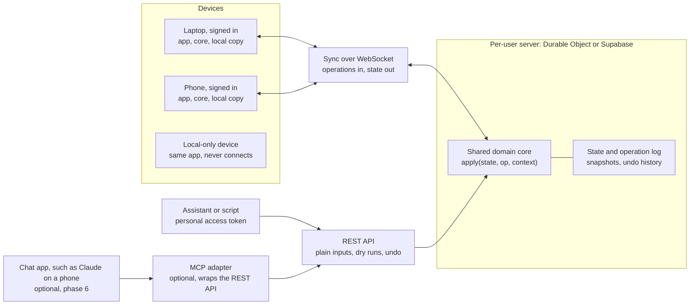

# TaskFlow sync and API design

Design doc · draft · 2026-10-23

TaskFlow gains optional accounts, so one person sees the same tasks and schedule on every device, and an AI assistant can read and change them through a REST API. Using the app without an account, on localStorage alone, stays fully supported.

## Goals and non-goals

Goals:

- **Optional accounts.** The app works exactly as today without signing in. An account adds sync; it never gates a feature.
- **One person's data on many devices.** Tasks, the schedule, fixed blocks, work hours and the running timer appear on every signed-in device within a second or two.
- **An assistant as a first-class writer.** Through the REST API, an AI assistant can list tasks, add and edit them, schedule them and run the auto-scheduler, with the same results as the buttons in the app.
- **Offline keeps working.** A signed-in device without a connection still works, and catches up when it reconnects.

Non-goals for now:

- Sharing a schedule with other people, teams or delegates.
- End-to-end encryption. The server has to read the data to run the scheduler and answer the API (see [Security](#security-privacy-and-data-ownership)).
- Calendar import or export (Google, iCal). Worth doing later, on top of the same API.

## Where the code stands today

Most of what sync needs is already in place; three things are not. The scheduling logic is plain JavaScript and can run on a server, but it reads the system clock and timezone implicitly, and the app saves its whole state as one blob.

| Aspect | Today | What it means for sync |
| --- | --- | --- |
| Store API | `tasks.svelte.js` and `schedule.svelte.js` export about 25 operations: `addTask`, `editTask`, `completeTask`, `scheduleTaskNext`, `autoScheduleAll`, `commitOutlookDrop`, `startTimer`, `addFixedBlock`, `updateWorkSchedule` and more | Already shaped like a command set. These become the operations every client sends |
| Scheduling logic | `scheduler.js`, `scheduling.js`, `envelope.js`, `calendar.js`, `outlook-scheduler.js` have no DOM dependency | The server can run the same code, so an API call to "schedule this" matches the app's button exactly |
| IDs | Tasks, blocks and fixed blocks get `crypto.randomUUID()` on the client | Records can be created offline without asking the server for an ID |
| Deletes | Soft (`isDeleted: true`) | Deletions travel as ordinary updates instead of vanishing |
| Saving | `saveState` writes tasks, work schedule, timer and fixed blocks as one localStorage blob on every change | Syncing that blob would let two devices silently overwrite each other. Needs replacing with operations |
| Clock and timezone | The scheduler calls `new Date()` and local-time getters throughout | On a server "local" is UTC, so scheduling would land in the wrong hours. `now` and the timezone must be passed in |
| Timestamps | Tasks carry `lastModifiedAt`; fixed blocks and the work schedule do not | Rules out simple per-record "last write wins", which is one more reason to sync operations |
| Device settings | Theme in `taskflow_theme`, panel width in `taskflow_layout` | Separate keys already, which makes the per-device versus per-account split easy |

One correction surfaced while checking: `CLAUDE.md` says the auto-scheduler scales durations by `estimationMultiplier`. It does not; only `InsightsModal` reads it. That matters once the server runs the scheduler (see [Open questions](#open-questions)).

## Architecture

Every writer sends operations to one server per user, which applies them with the same domain core the browser runs. Writers here means the app on each device, assistants and scripts. The frontend stays a static site on GitHub Pages; only signed-in devices talk to the server.

Signed-in devices send operations and receive new state over one WebSocket. Assistants and scripts use the REST API with a personal access token. Chat apps that can only connect through MCP connectors would reach the same API through an optional adapter. A local-only device runs the identical app and core but never connects.

Three rules hold the design together:

- **Local-first.** Each device keeps a full copy and applies its own changes instantly. The network is for agreement, not for rendering.
- **Operations, not state.** Devices never upload their whole state. They send intents like `schedule.next`, which the server re-applies to the current state.
- **One writer per user.** The server applies one user's operations one at a time, so phone, laptop and assistant can never overwrite each other.

## The domain core

Every change to the data goes through one pure function, `apply(state, op, context)`, shared by the browser and the server. It is extracted from the Svelte stores, which become thin wrappers that call it and hold the result in `$state`.

The pieces:

- **State.** One plain object: `{ tasks, workSchedule, fixedBlocks, activeTimer, version }`. Small enough to ship whole: a heavy user has a few hundred tasks, tens of kilobytes.
- **Operation.** `{ id, type, args, at, tz, actor }`. `id` is a client UUID, so a retried send is applied once. `at` is when the operation was issued and `tz` is the issuer's IANA timezone. `actor` is `app`, or the name of the API token that sent it.
- **Context.** `{ now, timeZone }`, taken from the operation's `at` and `tz`. Nothing in the core calls `new Date()` or a local-time getter directly; `calendar.js` and the schedulers take the context instead.
- **Result.** The new state plus a short summary of what changed, which the API returns as its answer.

Fixing the clock and timezone first is what makes the core portable. With `now` passed in, the browser and the server compute the same slot for the same operation, and the logic becomes testable for the first time.

The operation catalogue, grouped:

| Group | Operations |
| --- | --- |
| Tasks | `task.add`, `task.edit`, `task.complete`, `task.restore`, `task.delete`, `task.lock`, `task.setRemaining`, `task.setElapsed` |
| Scheduling | `schedule.next`, `schedule.place`, `schedule.unschedule`, `schedule.auto`, `schedule.clear`, `schedule.outlookMove` |
| Timer | `timer.start`, `timer.pause`, `timer.resume`, `timer.finish` |
| Settings | `hours.update`, `block.add`, `block.edit`, `block.remove` |

Each maps one to one onto an existing store function, so the refactor moves code rather than redesigning it. `schedule.place` is what a drag commits; `schedule.next` is the ✦ button.

## Sync protocol

Devices send operations, the server applies them one at a time in arrival order, and every device converges on the server's state. Operations are intents ("schedule this at the next free slot") rather than diffs, so replaying one on newer state is well-defined: it simply finds the slot that is free now.

One round trip:

1. The device applies the operation locally at once, so the UI never waits, and adds it to a pending queue saved in localStorage.
2. It sends the operation with the state version it was applied on.
3. The server applies it with `apply`, increments the version, appends it to the log, and acknowledges with the new version.
4. The server pushes the new state, or the operations since the device's version, to every other connected device over a WebSocket.
5. A device receiving newer state replaces its base state and replays its still-pending operations on top. Anything the server already applied is dropped from the queue by operation `id`.

Behaviour in the awkward cases:

- **Offline.** The queue grows; on reconnect the device sends it in order, then pulls the operations it missed since its last version.
- **Two devices at once.** The server's order wins. Both devices end up with the same state, and neither loses an edit, because each edit is an operation, not a snapshot of the whole list.
- **The assistant runs auto-schedule while you drag a block on your phone.** Whichever arrives second is applied to the result of the first. Your drag is not undone by a stale copy of the plan.
- **The timer.** `activeTimer` lives in shared state, so starting it on the phone and stopping it on the laptop is just two operations. The running time is computed from `startedAt`, so devices agree without ticking over the network.
- **A rejected operation.** Rare, since most operations re-evaluate against current state. When one fails (completing a task that was deleted elsewhere), the server returns an error for that operation, and the device drops it and shows a short notice.

History: the server keeps the operation log plus a periodic snapshot, so a new device loads the latest snapshot and the few operations after it. The log is also what makes undo and a "changed through the API" history possible.

## Accounts and local-only mode

Local-only is the default and runs the same code path as a signed-in device, minus the network. Operations go through `apply` and land in localStorage either way; signing in only adds the send-and-receive half of the protocol.

That keeps local-only from rotting into a second-class mode: there is one code path, tested by everyone.

**Signing in on a device that has local data:**

- Empty account: the local state is uploaded as the account's first snapshot. This is the expected case for existing users.
- Account already has data and the device has data: ask once. The choices are merge (union by task id, newer `lastModifiedAt` wins), keep the account's, or keep this device's.
- The device has nothing: download the account's state.

**Signing out:** the device keeps a local copy and carries on in local-only mode, so nothing vanishes from under the user. An explicit "remove data from this device" clears it.

**What follows the account and what stays on the device:**

| Setting | Where it lives | Why |
| --- | --- | --- |
| Tasks, scheduled blocks, fixed blocks | Account | The point of syncing |
| Work hours, buffer | Account | The scheduler needs them server-side |
| Running timer | Account | So it can be stopped from any device |
| Completed-task history | Account | Feeds Insights and the estimation multiplier |
| Home timezone | Account | See [Time and timezones](#time-and-timezones) |
| Theme | Account, overridable per device | Usually the same everywhere |
| Task-panel width, current pane, planner date, sort order | Device | Depends on the screen in front of you |

Export and import work in both modes: a JSON file in the same shape as today's `taskflow_v2` blob, so a local-only user has a backup path too.

## Backend choice

Recommendation: Cloudflare Workers with one Durable Object per user. The two hardest requirements fall straight out of that model: strict ordering of writes from several devices plus an assistant, and an authenticated API that runs the scheduler. The decision can wait until phase 3, because the domain core and the protocol are identical either way.

A Durable Object is a small stateful server instance addressed by a name, here the user's id. It handles one request at a time and has its own storage, which is exactly the single writer the sync protocol wants.

| Requirement | Workers + Durable Object per user | Supabase |
| --- | --- | --- |
| Login | Bring your own: GitHub OAuth through a library, or a hosted provider | Built in: email magic links, GitHub and other OAuth |
| One writer per user, in order | Built in: a Durable Object processes its requests one at a time | On you: a version column with compare-and-swap, or a Postgres function that locks the user's row while applying |
| Running the shared JS core | Same JavaScript, in the Worker | In Edge Functions (Deno); same code with a small build step |
| Pushing changes to devices | WebSockets held by the Durable Object | Realtime subscriptions on table changes |
| Hosting the REST API | The Worker itself | Edge Functions |
| An MCP adapter later (optional, phase 6) | Cloudflare publishes an agents SDK and an OAuth provider library for remote MCP servers | An Edge Function; the OAuth flow that MCP clients expect is wired up by you |
| Storage | SQLite storage inside each Durable Object | Postgres, queryable from a dashboard, easy to back up |
| Code you write | More: auth and the protocol | Less for auth and storage, more glue for ordering |
| Lock-in | The Durable Object model is Cloudflare-specific | Postgres, open source, self-hostable |

What would change the recommendation:

- You want login, a data browser and backups handed to you, and would rather write the ordering glue than an auth flow. Choose Supabase.
- You want to be able to self-host everything later on a plain server. Choose Supabase, or a small Node server with SQLite, which works the same way at this scale.

Product capabilities in this section are from memory; confirm them against current Cloudflare and Supabase docs before phase 3.

## The REST API

Assistants, scripts and any future integration use one REST API. Everything that makes it pleasant for an assistant lives in the API itself, so any client that can make an HTTP request gets it: plain inputs, dry runs, undo and readable responses. An agent with a shell, such as Claude Code, needs nothing more than a token and the agent guide.

| Method and path | Does | Operation |
| --- | --- | --- |
| `GET /v1/overview` | Today's schedule, the next few work days, and open tasks ranked by current pressure | none |
| `GET /v1/tasks?state=open` | Tasks filtered by state: `open`, `scheduled`, `unscheduled`, `completed` | none |
| `GET /v1/state` | The full state and its version, as devices load it | none |
| `POST /v1/tasks` | Creates a task from plain inputs (below) | `task.add` |
| `PATCH /v1/tasks/{id}` | Renames, re-estimates or moves the deadline | `task.edit` |
| `POST /v1/tasks/{id}/complete` | Marks it done | `task.complete` |
| `DELETE /v1/tasks/{id}` | Soft-deletes | `task.delete` |
| `POST /v1/tasks/{id}/schedule-next` | Places it at the next free slot, like the ✦ button | `schedule.next` |
| `PUT /v1/tasks/{id}/placement` | Places it at a given day and time | `schedule.place` |
| `DELETE /v1/tasks/{id}/placement` | Removes its blocks | `schedule.unschedule` |
| `POST /v1/schedule/auto` | Plans all unlocked, unscheduled tasks. Preview by default | `schedule.auto` |
| `POST /v1/schedule/clear` | Clears unlocked blocks. Preview by default | `schedule.clear` |
| `POST /v1/timer/start`, `POST /v1/timer/stop` | Time tracking | `timer.start`, `timer.finish` |
| `POST /v1/undo` | Reverts recent operations | log replay |
| `POST /v1/ops` | Applies raw operations, as devices send them | any |

**Plain inputs instead of a pressure curve.** An assistant cannot drag the envelope, and "peak pressure 0.7" means nothing to it or to the person asking. `POST /v1/tasks` takes what people say and maps it onto the model:

- `due` becomes `peak`.
- `starts_mattering`, if given, becomes `onset`. Otherwise `onset` is two days before `due`, matching the app's current default spacing.
- `stakes` becomes `peakPressure`: low 0.3, medium 0.5, high 0.7 (the app's default), critical 0.95. These values are a proposal to tune.
- `estimate` is in minutes, defaulting to 30 as the Add Task modal does.

A client that understands the model can still pass `onset`, `peak` and `peakPressure` directly.

**Dry runs for bulk changes.** Auto-schedule and clear rewrite the whole plan, so by default they return the proposed result together with the state version it was computed on. Committing repeats the call with `{ "confirm": true, "version": <that version> }`. If anything changed in the meantime, the call fails with `409` and "the plan changed, preview again", rather than applying a stale plan.

**Undo.** The server keeps the state before each of the last 50 operations. Undoing the latest restores that state. Undoing an older one restores the state before it and replays everything after it except the undone operation, which works because operations are intents.

**Readable responses.** Every write returns `{ summary, changed, version }`. `summary` is one plain sentence, such as "Scheduled Review pull request for Tue 27 Oct, 10:15 to 11:15", which an assistant can relay as it stands.

**Authentication.** Personal access tokens are created in Settings, shown once, scoped read-only or read and write, and revocable. They're sent as `Authorization: Bearer <token>`. Every operation records the token as its `actor`, so the app can mark tasks changed through the API and list recent API changes.

**Documentation for agents.** An OpenAPI spec served at `/v1/openapi.json`, plus a short agent guide in the repo with `curl` examples. The guide is written so it can be dropped into a Claude Code skill as it stands.

### Optional: an MCP adapter

Build this only if a chat app needs access. Chat apps such as the Claude app on a phone or desktop generally can't make authenticated requests to an arbitrary API from a conversation. They connect to outside services through connectors, which are remote MCP servers. If "tell the assistant on my phone to add a task" becomes a real use, an adapter exposes each endpoint above as an MCP tool and forwards the call to the REST API.

- **It's thin.** Each tool maps one to one onto an endpoint, with no logic of its own: plain inputs, dry runs and undo already live in the API.
- **The real cost is OAuth.** Connectors expect an OAuth flow, whereas personal tokens avoid one. The user approves the connector once on a TaskFlow consent page, choosing read-only or read and write, and can revoke it from Settings.
- **Nothing else depends on it.** It can be added, or never added, without touching phases 1 to 5.

## Time and timezones

The account gets a home timezone, and scheduled blocks keep their current meaning: wall-clock times in the timezone of whoever is looking. This is the biggest hidden assumption the backend exposes, because today "local time" is simply the browser's.

The data mixes two models already:

- **Blocks are floating.** A block is a date string plus minutes into the day (`2026-10-21`, `540`). It means 9:00 wherever the viewer is.
- **Onset and peak are absolute.** They are stored as instants, so a deadline of 17:00 in Brisbane is 08:00 in London.

The proposal:

- Keep blocks floating. For a personal planner, "9:00 is deep-work time" should stay 9:00 when you travel.
- Keep onset and peak absolute. A deadline is a real moment.
- Store a home timezone (an IANA name, such as `Europe/London`) on the account, set from the first device that signs in.
- Every operation carries the issuer's timezone in `tz`. The server applies an API request in the home timezone unless the request supplies one.
- When a device's timezone differs from the home timezone, show a one-line notice in the planner header, with an option to switch the home timezone.

The day boundary already follows this rule in the app: `parseLocalDate` and `toISODate` treat dates as local. The change is that "local" becomes an explicit value in the context instead of whatever the machine reports.

## Security, privacy and data ownership

Only the account owner, and the tokens they create, can read or change their data, and the owner can take all of it out or delete it at any time. Task lists are personal; the design treats them that way.

- **Access.** Every request is tied to one user, and a Durable Object (or Postgres row policy) only ever serves that user's data. There is no admin view of task content.
- **Encryption.** Encrypted in transit and at rest by the provider, but not end to end. The server must read tasks to run the scheduler and answer the API. Stating this plainly in the app is better than implying more.
- **Sessions in the browser.** The site is on GitHub Pages and the API on another origin. The session uses an `HttpOnly`, `Secure` cookie scoped to the API domain, with CORS allowing only the app's origin. No long-lived token in localStorage.
- **API token limits.** Read-only scope is available. Write tokens cannot hard-delete (deletes stay soft), bulk changes require the dry-run confirmation, and writes are rate limited, for example to 60 operations a minute, so a looping assistant can't flood the log.
- **Export.** A full JSON export from Settings, in the same shape as the local-only export.
- **Backups.** A daily snapshot per user, kept for 30 days.
- **Deletion.** Deleting the account removes the state, the log, snapshots and tokens. Devices fall back to local-only with whatever copy they hold.

## Build plan

Five phases, each shippable on its own, plus an optional sixth. Phases 1 and 2 need no backend and improve the app as it is, so they're the right place to start. The backend choice is made at phase 3.

| # | Phase | Delivers | Verified by |
| --- | --- | --- | --- |
| 1 | Domain core | `apply(state, op, context)` extracted from the stores; clock and timezone passed in; the operation catalogue; stores become thin wrappers | The app behaves identically. First unit tests for the core, including `schedule.next`, `schedule.auto` and timezone cases. A Playwright smoke suite built from the checks used in the mobile work |
| 2 | Local operation log | Every change flows through operations in local-only mode too; JSON export and import in Settings | Export then import round-trips exactly; reloads preserve state; the pending queue survives a reload |
| 3 | Backend and accounts | Backend chosen; login; per-user state, log and snapshots; the operations endpoint; WebSocket push | Two browsers converge within about 2 seconds; offline edits apply on reconnect; simultaneous edits converge without loss |
| 4 | Sign-in in the app | Sign in and out; first-sign-in upload and the merge prompt; account versus device settings; home timezone | An existing local-only user signs in and loses nothing; signing out leaves a working local copy |
| 5 | REST API and tokens | Personal access tokens; the endpoints with plain inputs, dry runs, undo and readable summaries; the OpenAPI spec; the agent guide | An agent given only a token and the guide adds, schedules and auto-schedules tasks (preview, then confirm); changes appear live on every device; undo reverts them |
| 6 | MCP adapter (optional) | Tools wrapping the REST endpoints; OAuth consent | A chat app on a phone adds and schedules a task through a connector |

Phase 1 is the riskiest refactor, because it touches every store. It's also the one that pays off even if nothing else ships: testable scheduling logic and no hidden dependence on the machine's clock. Phase 6 waits until a chat app actually needs access.

## Open questions

- [ ] **Where will you talk to the assistant?** Claude Code or another agent on a laptop needs only the REST API (phase 5). A chat app on the phone needs the MCP adapter (phase 6).
- [ ] **Backend.** Workers with Durable Objects, or Supabase? Decide before phase 3, against the criteria in [Backend choice](#backend-choice).
- [ ] **Login method.** GitHub OAuth only, or email magic links too? Passkeys later?
- [ ] **API writes: direct or confirmed?** Apply immediately with undo, as proposed, or hold changes made through the API for approval in the app?
- [ ] **Merge on first sign-in.** Is "newer `lastModifiedAt` wins" good enough, or should conflicting tasks be shown side by side?
- [ ] **Estimation multiplier.** Should the scheduler scale durations by `estimationMultiplier`, as `CLAUDE.md` claims? Settle it in phase 1, before the server starts running the scheduler.
- [ ] **Stakes values.** Are low 0.3, medium 0.5, high 0.7 and critical 0.95 the right pressure levels for tasks created through the API?
- [ ] **API domain.** Which domain hosts the API, so cookies and CORS can be configured for the GitHub Pages origin?
- [ ] **Travel.** Is a notice enough when a device is away from the home timezone, or should the home timezone follow the device automatically?
